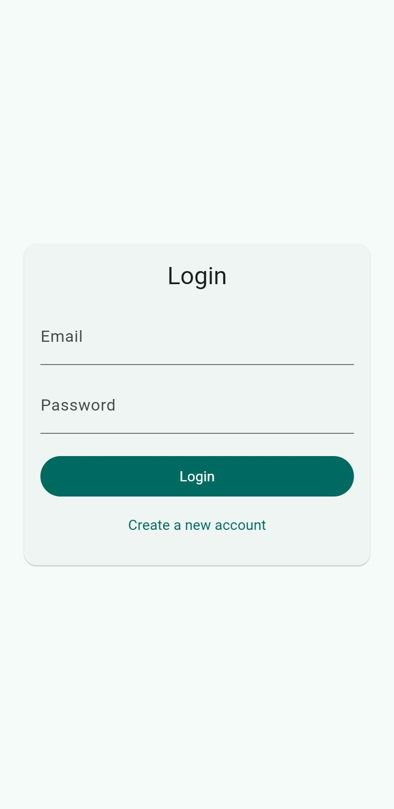
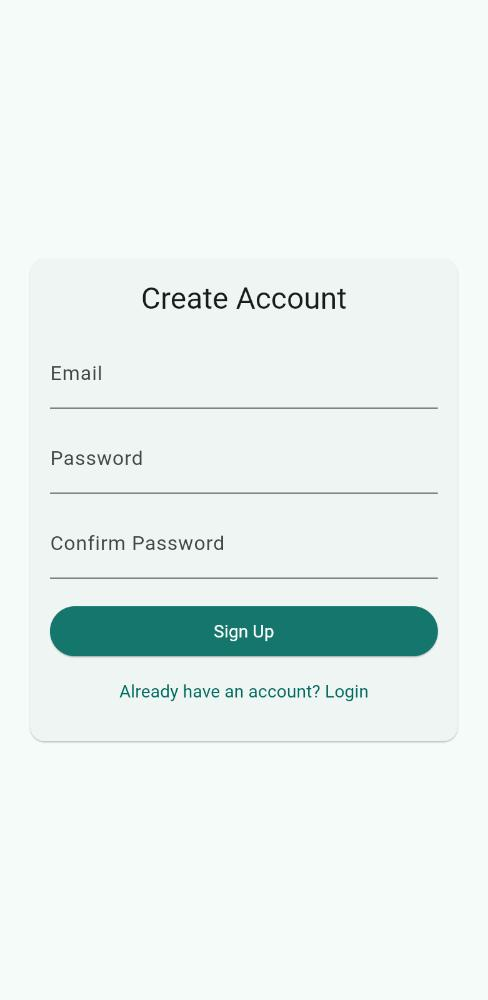

# Ideas Board

A shared ideas board built with **Flutter** and **Firebase**. Users create an account, post ideas with a title and a description, and see ideas from everyone in one list. The app talks to Firebase through its REST APIs and keeps a local copy so the board still shows when the network is down.

## Screenshots

<p align="center">
  
  &nbsp;&nbsp;&nbsp;
  
</p>

<p align="center"><em>Login (left) and create-account (right) screens.</em></p>

## Features

- **Email and password authentication** with the Firebase Authentication REST API: sign up, log in and log out
- **Form validation**: valid email, passwords of at least 6 characters, matching confirmation, and required title and description
- **Stay signed in**: the session is saved on the device and restored on the next launch, and it logs out automatically when the token expires
- **Shared ideas board** stored in Firebase Realtime Database, newest idea first
- **Add an idea** with a title and a description
- **Delete an idea** by swiping it to the left or tapping the delete icon
- **Refresh** with pull-to-refresh or the refresh button
- **Offline cache**: ideas are saved on the device for each user and shown while the network request runs, or if it fails
- **Clear error messages** for failed sign-ins, network errors, timeouts and server errors

## Tech Stack

- **Framework:** Flutter (Dart SDK 3.11 or newer)
- **State management:** [`provider`](https://pub.dev/packages/provider) (`ChangeNotifier` and `ChangeNotifierProxyProvider`)
- **Networking:** [`http`](https://pub.dev/packages/http) against the Firebase Auth (Identity Toolkit) and Realtime Database REST APIs
- **Local storage:** [`shared_preferences`](https://pub.dev/packages/shared_preferences) for the saved session and the ideas cache
- **Design:** Material 3 with a teal color scheme

## Project Structure

```
lib/
├── main.dart                       # app entry point and providers
├── config/
│   └── firebase_auth_config.dart.example   # template for your Firebase Web API key
├── models/
│   └── idea.dart                   # Idea model (Firebase and cache conversions)
├── providers/
│   ├── auth_provider.dart          # sign up, log in, auto login, auto logout
│   └── ideas_provider.dart         # fetch, add, delete and cache ideas
└── screens/
    ├── auth_gate_screen.dart       # chooses between the auth and ideas screens
    ├── auth_screen.dart            # login and sign-up form
    ├── ideas_screen.dart           # list of ideas
    └── add_idea_screen.dart        # form to add an idea
test/
└── widget_test.dart                # widget test for the auth screen
docs/                               # screenshots
```

## Data Model

Ideas live under `/ideas` in Realtime Database, one child per idea with a generated key:

| Field | Type | Notes |
| --- | --- | --- |
| `title` | string | the idea's title |
| `description` | string | the idea's description |
| `userId` | string | the Firebase user ID of the author |

## Getting Started

### Prerequisites
- [Flutter SDK](https://docs.flutter.dev/get-started/install) (Dart 3.11 or newer)
- A free [Firebase](https://console.firebase.google.com) account
- An Android emulator or device, or a browser

### 1. Create the Firebase project
1. In the Firebase console, create a project.
2. Under **Authentication**, enable the **Email/Password** sign-in method.
3. Under **Realtime Database**, create a database and note its URL.
4. Open **Project settings > General** and copy the **Web API Key**.

### 2. Add your settings to the app
1. Copy `lib/config/firebase_auth_config.dart.example` to `lib/config/firebase_auth_config.dart` and paste your Web API key into it. This file is not committed to the repository. You can also pass the key at run time with `--dart-define=FIREBASE_WEB_API_KEY=YOUR_KEY`.
2. In `lib/providers/ideas_provider.dart`, replace the `_baseUrl` value with your own Realtime Database URL.

### 3. Set the database rules
Every request carries the signed-in user's token. In the Realtime Database **Rules** tab, a suggested rule set lets signed-in users read all ideas and lets only the author delete an idea:

```json
{
  "rules": {
    "ideas": {
      ".read": "auth != null",
      "$ideaId": {
        ".write": "auth != null && (!data.exists() || data.child('userId').val() === auth.uid)"
      }
    }
  }
}
```

### 4. Run the app

```bash
git clone https://github.com/Youstina-Raouf/Ideas-App.git
cd Ideas-App
flutter pub get
flutter run
```

### Run the tests

```bash
flutter test
```

## Known Limitations and Ideas
- Every idea shows a delete button, even for ideas written by other users. The database rules above stop the request, but the app does not hide the button
- There is no edit screen and no password reset
- Ideas: show the author's name instead of the user ID, add an edit screen and search

## Author

Youstina Raouf
